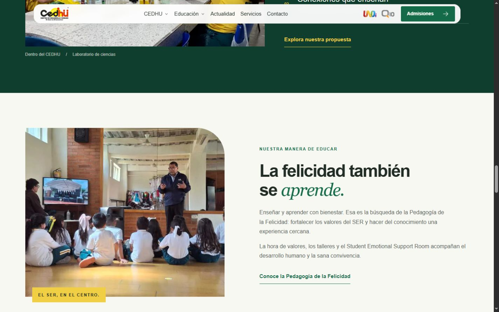
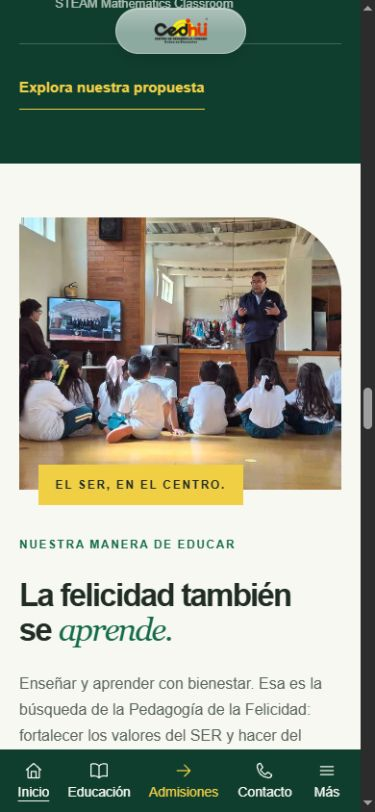

# CEDHU — cierre P3 y auditoría de animaciones

Fecha: 23 de octubre de 2026. Repositorio local: `C:\Users\Cedhu IT\Documents\cedhu-web-2027`. Navegador: Chromium integrado, servidor de desarrollo `http://127.0.0.1:4321/`.

## A. Diagnóstico inicial

La portada compone, en este orden: Hero, CampusModel, WhyCedhu, QuickAccess, IdentityIntro, EducationalLevels, Technology, HumanFormation, EvidenceSection, NewsSection, FAQ y AdmissionsCTA. Header y Footer pertenecen al layout.

P1 contiene 47 objetivos declarativos en total al incluir P2. El controlador compartido prepara exclusivamente elementos inicialmente fuera de pantalla, usa IntersectionObserver con margen inferior del 10 % de la altura y threshold 0, deja de observar tras activar y dispone de finalización por transitionend y temporizador. Conserva estados, resuelve foco/anclas, evita instancias duplicadas y libera contenido al reducir movimiento o limpiar la página. No hay listener de scroll por sección. Los tests cubren fallos parciales y ausencia de soporte.

P2 mueve el contenedor figure de Technology y el contenedor fotográfico de HumanFormation, sin modificar crops, dimensiones ni lazy loading. Technology utiliza 550 ms en escritorio y 450 ms en móvil; HumanFormation, 500/450 ms. La entrada lateral de HumanFormation pasa a vertical bajo 48rem. Los textos mantienen sus entradas independientes y los retrasos móviles se eliminan.

El hero conserva el controlador con resorte crítico, límites geométricos, tracking de signos opuestos, RAF que se detiene al estabilizar y scroll decorativo de bombillo/figuras. Las entradas, flotación de polaroid y tracking usan canales separados. Sus tres fotografías mantienen 700 ms y retrasos 0/160/320 ms; la franja amarilla conserva su entrada independiente. Paleta MACUB, tamaños, posiciones, corona y subrayado intactos.

Conflictos revisados: hover de niveles sobre img y reveal sobre article; hover de evidencias sobre article/img y reveal sobre wrapper; noticias con hover sobre img y reveal exterior. WhyCedhu conserva la columna sticky desde 62rem. El contenedor 3D no recibe reveal ni parallax. Solo el hero contiene decoración editorial autónoma con movimiento continuo/interactivo en estas secciones; los demás elementos candidatos son principalmente contenido, bordes o controles.

## B. Intervenciones seleccionadas: cero

Se aplicó la opción explícita de cerrar P3 mediante auditoría cuando ningún efecto adicional aporta una mejora real. No se añadió CSS, TypeScript, markup, wrappers, listeners, timelines ni dependencias.

| Candidata | Decisión y motivo |
| --- | --- |
| IdentityIntro | Conservar los bordes de pilares como separadores estáticos. El escalonamiento P1 ya introduce ritmo; desplazar los números animaría contenido y duplicaría ese efecto. |
| Technology | Conservar fotografía, fondo oscuro y enlaces. El separador `/` es parte del pie de foto, no una decoración independiente que justifique otro movimiento. |
| HumanFormation | Conservar el rótulo amarillo unido a su fotografía. Separarlo mediante parallax rompería la relación visual y semántica del pie con P2. |
| AdmissionsCTA | Mantener el fondo y cierre estables. Las flechas son iconos funcionales de enlaces; moverlas por scroll no mejora la transición. |

No existe una duración, recorrido ni activación P3 nueva. Escritorio, móvil, ausencia de soporte y movimiento reducido conservan exactamente las presentaciones existentes. No se proponen fases cosméticas adicionales.

## C. Archivos de esta fase

Solo se añadieron estos archivos de documentación/evidencia:

- `C:\Users\Cedhu IT\Documents\cedhu-web-2027\docs\qa\animations-p3\README.md`: este informe, decisiones, pruebas y límites.
- `C:\Users\Cedhu IT\Documents\cedhu-web-2027\docs\qa\animations-p3\desktop-1440.jpg`: transición Technology/HumanFormation tras completar reveals.
- `C:\Users\Cedhu IT\Documents\cedhu-web-2027\docs\qa\animations-p3\mobile-390.jpg`: la misma continuidad en móvil.

No se modificaron fuentes de producción durante P3. Las capturas documentan composición y estado final; no prueban por sí solas una secuencia temporal.

## D. Verificaciones ejecutadas

### Técnicas

- `npm run build`: correcto; 31 páginas generadas. Incluye prebuild CMS y postbuild check:site.
- `check:site`: correcto; 30 páginas comprobadas, 4295 referencias locales y 9 PDFs; metadatos, encabezados, alternativas, fragmentos, sitemap y separación de estilos.
- `npm run check:proyectos:build`: correcto; ejecutó otra compilación y verificó 470 archivos versionables y 502 archivos públicos. No se modificaron fuentes ni configuración de /proyectos.
- `node --test scripts/animations/*.test.mjs`: 16/16 correctos. Diez del reveal compartido y seis de perfiles/física/controlador del hero. Incluyen foco, anclas, cambios de preferencias, fast scroll, limpieza, reutilización, límites del resorte y ausencia de mediciones de layout dentro del RAF.
- `git diff --check`: correcto; únicamente avisos de normalización CRLF/LF en archivos ya modificados antes de P3.
- `git status`, `git diff --numstat` y revisión del diff: se distinguió el trabajo local previo de los nuevos artefactos de esta fase. `package.json` y `package-lock.json` sin cambios.
- HTTP local: `/`, `/nosotros/`, `/oferta-educativa/`, `/noticias/`, `/admisiones/`, `/contacto/` y `/documentos/` respondieron 200 con título de página.

### Navegador real

| Área | Prueba realizada y resultado |
| --- | --- |
| 1440×900 | Recorrido completo en incrementos de 585 px, con capturas de cada parada, desde hero hasta footer. Sin contenido permanentemente oculto ni overflow. Regreso ascendente y segunda pasada con estados visibles. |
| Scroll rápido | Recarga, salto descendente hasta footer y regreso al inicio. Se revisó que el contenido que entra en pantalla se libera. Elementos saltados pueden seguir pending hasta su primera visita; no se reinician los ya terminados. |
| 1366×768 | Hero sin fragmento, saltos por la portada, IdentityIntro, transición HumanFormation/Evidence y cierre. Sin overflow en las muestras. También se verificó llegada inicial mediante el fragmento WhyCedhu. |
| 1024×768 | Hero, recorrido por IdentityIntro, evidencias en dos columnas y footer; vuelta al inicio. Sin overflow en las muestras. |
| 390×844 | Recorrido completo en 22 pasos hasta footer; segunda pasada y vuelta al inicio. Los 47 objetivos terminaron en done, con cero pending/running. Sin overflow en los pasos registrados ni imágenes cargadas rotas. |
| 320×844 | Recorrido completo en 21 pasos hasta footer; tarjetas apiladas, noticias y cierre revisados. Sin overflow en los pasos registrados. |
| P2 | Vistas de la fotografía de laboratorio y HumanFormation durante el descenso y al volver; imágenes visibles y posiciones finales estables. Adaptación vertical móvil comprobada también por CSS. |
| Hero | Puntero real a derecha e izquierda: signos opuestos en bombillo/spark y respuesta gradual. Muestras de bombillo ≈40/−41 px y spark ≈−38/+39 px. Fotos siguen opacity 1 y transform none tras completar entrada. |
| Scroll hero | Puntero fuera, scrollY 225: desplazamiento X de bombillo e Y de figuras; los demás motivos sin nueva contribución de scroll. La física y la separación de movimientos también pasan tests. |
| Secuencia fotográfica | Estilos calculados: hero-photo-enter, duración 0.7 s, inicios 0/0.16/0.32 s. Polaroid conserva entrada y flotación separadas. No se ajustó ningún valor. |
| Hover niveles | Imagen con scale 1.035; article en transform none tras reveal. |
| Hover evidencias | Article elevado −4 px, imagen scale 1.025 y wrapper de reveal en transform none. |
| Hover noticias | Imagen con scale 1.025. |
| Botón | Hover del CTA educativo del hero: translateY −2 px. |
| Navegación | Click real en CTA educativo → /oferta-educativa/, encabezado correcto, vuelta mediante historial. Ancla «Descubre el CEDHU» → #por-que-cedhu con cero reveals pendientes dentro del destino. |
| Teclado/FAQ | Tab alcanza skip-link con outline visible. Primera pregunta abre con click, muestra respuesta y cierra con Enter. No se anima altura. |
| Maqueta 3D | data-ready presente; canvas Three de 1280×640. Puntero sobre la maqueta, apertura del recorrido, vídeo readyState 4 sin error; Escape cierra y devuelve foco al botón de recorrido. |
| Movimiento del sitio | Activación durante sesión a 320 px: cero reveals ocultos/pending y cero animaciones en motivos. Recarga mantiene checkbox y html[data-motion="reduced"]. Comprobado también en escritorio: las tres fotos tienen animation none. Preferencia restaurada al estado original al terminar. |
| Consola | Sin errores ni advertencias registrados en la captura de consola final de la sesión. |

Las primeras muestras inmediatamente posteriores a un scroll móvil llegaron a leer opacity 0 antes de que se entregara el callback de IntersectionObserver. Tras asentarse y recorrer la página, los 47 objetivos finalizaron. No se interpreta esa muestra instantánea como contenido permanentemente bloqueado ni como una medición de duración de un hueco.

### JavaScript desactivado: comprobación estática, no visual

La API del navegador habilitado no ofrece desactivar scripts. Se inspeccionaron el HTML de producción `dist/index.html`, CSS y controlador; no se simuló una prueba visual sin JavaScript.

El HTML generado incluye 47 atributos data-reveal, **cero** atributos data-reveal-state, 31 imágenes y 155 enlaces. Las tres fotos principales están presentes. Las reglas que ponen opacity 0 para P1/P2 requieren un estado que solo añade el controlador tras inicializar correctamente. Las fotos iniciales del hero tienen animaciones CSS finitas y recuperan su presentación visible, sin depender del script. El recorrido tiene alternativa noscript. Las decoraciones SVG del hero pueden omitirse sin scripts: no son contenido esencial.

### Movimiento del sistema y otros límites

La API habilitada solo expone viewport y visibilidad; no permite emular prefers-reduced-motion. Se revisaron las reglas CSS de dicha preferencia y los listeners, y pasan las pruebas con dobles de matchMedia. Queda pendiente la comprobación visual con la preferencia del sistema real. La preferencia persistida del sitio sí se probó en navegador.

No se ejecutaron Lighthouse, mediciones comparativas de LCP/INP, dispositivos físicos, varios motores ni auditoría exhaustiva de lectores de pantalla. No hay comprobador Astro/TypeScript independiente instalado; build y las pruebas de TypeScript con Node pasan. No se instalaron herramientas para ampliar la auditoría.

## E. Regresiones y advertencias

No se identificaron defectos bloqueantes de animación en las pruebas realizadas. No se aplicaron correcciones ni se modificaron P1, P2 o hero. El recorrido y las capturas son observaciones del navegador disponible, no una garantía de todos los equipos.

Permanecen las advertencias existentes: colección eventos sin entradas y chunk mayor de 500 kB. No se introdujeron advertencias P3; esta fase no cambia el bundle ni añade trabajo de renderizado. No se hicieron refactors fuera de alcance para resolverlas.

## F. Estado de Git

Se preservaron los diez archivos que ya estaban modificados al comenzar:

- docs/qa/hero-motion/README.md
- docs/qa/hero-motion/desktop-1440.jpg
- docs/qa/hero-motion/mobile-390.jpg
- scripts/animations/hero-motion.test.mjs
- src/components/sections/Hero.astro
- src/scripts/animations/hero-motion.ts
- src/scripts/animations/hero-parallax.ts
- src/styles/components/hero-decorations.css
- src/styles/components/hero.css
- src/styles/tokens.css

Estos cambios pertenecen a las tareas previas y no se atribuyen a P3. Los únicos archivos añadidos por P3 son los tres artefactos de esta carpeta. Sin commits, push ni despliegues. Sin dependencias nuevas.

## G. Diagnóstico para producción

**2. Completo con verificaciones pendientes.** El desarrollo de animaciones queda cerrado; no se encontraron problemas concretos que impidan publicar en la muestra examinada. Quedan la prueba visual sin JavaScript y la preferencia de movimiento del sistema real, además de la revisión final de publicación. Estas limitaciones de validación no se presentan como defectos demostrados.

Lista breve para el lanzamiento, propuesta sin ejecutar ni cambiar configuraciones de despliegue:

- Compilar el candidato definitivo con las variables de producción previstas.
- Recorrer navegación, enlaces y anclas en la vista previa final.
- Confirmar responsive y foco/teclado en dispositivos objetivo; completar movimiento reducido del SO y prueba sin JavaScript.
- Revisar descarga de fotografías, PDFs, modelo y vídeo en la URL final.
- Verificar las integraciones existentes mediante sus flujos habituales en el entorno previsto.
- Confirmar ausencia de errores bloqueantes antes de autorizar publicación.

